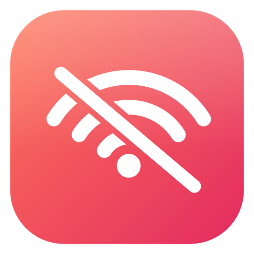

<p align="center">
  
</p>

<h1 align="center">GoOffline</h1>

<p align="center">
  <b>Make any Windows program think your internet is unplugged.</b><br>
  One switch. Just that program. Free and open source.
</p>

<p align="center">
  <a href="https://github.com/bjdevelopes/GoOffline/releases/latest"></a>
  <a href="https://github.com/bjdevelopes/GoOffline/blob/main/LICENSE"></a>
  
  <a href="https://buymeacoffee.com/bjdevelopes"></a>
</p>

<p align="center">
  <a href="https://bjdevelopes.github.io/GoOffline/"><b>Website</b></a> ·
  <a href="https://github.com/bjdevelopes/GoOffline/releases/latest"><b>Download</b></a> ·
  <a href="#how-it-works">How it works</a> ·
  <a href="CONTRIBUTING.md">Contributing</a>
</p>

---

## Download

Grab the latest `GoOffline-vX.Y.Z-win-x64.zip` from
[Releases](https://github.com/bjdevelopes/GoOffline/releases/latest), unzip it,
and run `GoOffline.exe`. You'll get one UAC prompt — that's for the firewall edits.

Windows 10 and Windows 11 only.

## How it works

### Tier 1 — Firewall (default)
Adds inbound + outbound block rules in Windows Firewall for the chosen `.exe`,
then resets its open IPv4 TCP connections so the cut is immediate. Flipping the
switch off deletes the rules. Rules show up as `GoOffline - ...` in Windows
Defender Firewall under the group **GoOffline**.

### Tier 2 — Hard mode (optional checkbox)
For programs that still get online. GoOffline injects a tiny hook DLL into the
running process and patches its import tables so every network call fails:

- `ws2_32`: `connect`, `WSAConnect`, `getaddrinfo`, `GetAddrInfoW`, `gethostbyname`, `WSAStartup`
- `wininet`: `InternetOpenA/W`, `InternetConnectA/W`
- `winhttp`: `WinHttpOpen`, `WinHttpConnect`
- `kernel32`: `LoadLibrary*` — so DLLs loaded later get patched too

Only takes effect while the target is running. New instances get hooked within
~2 seconds. **Won't work on anti-cheat games (Valorant, Fortnite, EAC, BattlEye) —
the kernel driver blocks remote DLL loads.** The firewall rule still catches those.

## Build from source

Requires .NET 8 SDK and (for Hard mode) VS C++ build tools.

```powershell
./native/GoOfflineHook/build.ps1
dotnet publish src/GoOffline -c Release -o publish
```

Full details in [CONTRIBUTING.md](CONTRIBUTING.md).

## Support the project

GoOffline is free and always will be. If it saved you time:

<p>
  <a href="https://buymeacoffee.com/bjdevelopes">
    
  </a>
</p>

## License

[MIT](LICENSE).
